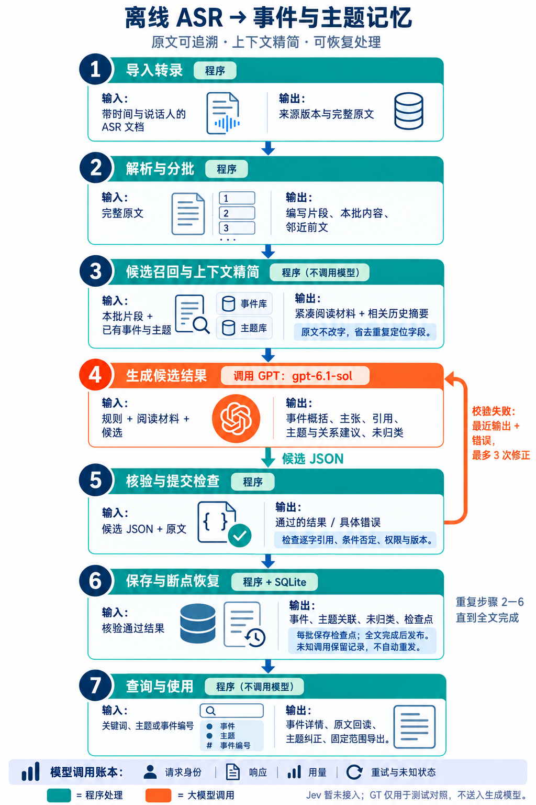

# 离线ASR事件与主题记忆：部署与复现

**2026-10-31交付状态：待修复审阅版。** 上轮最终评审新发现的两项P1及一项P2尚未修复，本次发布当前代码供负责人查看和复核，不能作为最终验收通过版。具体问题和独立复现命令见[当前已知问题](docs/当前已知问题.md)。

2026-10-30补充复测发现并修复了“单片段引用截掉邻近否定”的漏测变体。请使用本次新包；独立复现命令和版本排查见[评审复测](docs/评审复测.md)。

读取带时间和说话人的ASR文档，生成有原文依据的事件、有限主张及主题关联，支持查询、原文回读、人工纠正和固定范围导出。本版本已补齐评审第1—5项工程修复，并交付对应复现测试。

新增TXT输入适配：TXT先转换为MD兼容转录，再进入原有流程；旧MD继续支持，转换不调用模型、不改写原文。详细格式和独立转换命令见[TXT输入说明](docs/TXT输入说明.md)。

## 三种交付内容

| 内容 | 包含什么 |
| --- | --- |
| GitHub源码 | 程序、前端、两种启动脚本、合成测试和说明；无真实数据或凭据 |
| event-memory-delivery.zip | 同版本代码和测试，另附最新已有真实结果、原始转录、固定GT及报告；不含凭据 |
| event-memory-authorization.zip | 单独提供的可选授权转移文件；不进入GitHub，也不放入代码/结果包 |

项目仓库：https://github.com/Kallen6669/event_memory 。`release-manifest.json`记录交付代码提交和文件摘要，`delivery-verification.json`记录打包验证。

## 环境与启动

Windows，Python 3.10或以上版本并加入PATH。解压到普通文件夹后运行，不要在压缩软件内直接双击。首次启动创建`.venv`并安装依赖，需要联网下载Python依赖；SQLite由Python自带，不需要另装数据库。所有页面只监听本机，不提供公网多人部署。

### 方式一：直接查看已有结果

双击`start-view.cmd`，自动打开`http://127.0.0.1:8765/`。可以查询事件和主题、查看主张与证据原文、纠正主题、固定选择及导出。单纯查看不调用模型，也不需要账户授权。

初次启动将`delivery_data/results/`的业务库和账本备份到`.runtime/handoff-view/`作为可操作工作副本；交付原件不变。再次启动保留你的页面修改。页面上的生成或追加复核按钮仍需要授权并消耗用量，不属于免费查看。

端口占用时执行`start-view.cmd --port 8770`。只检查结果，不开页面：

```bat
scripts\bootstrap.cmd view --check
```

GitHub只有源码，需要把私下收到的`delivery_data`文件夹放入项目根目录才能查看真实结果。

### 方式二：从原始ASR完整重新处理

先完成下面的授权步骤，再双击`start-run.cmd`。默认读取`delivery_data/input/TRANSCRIPT.md`；从空库生成新结果，控制台显示批次，完成后打开新结果页面。运行会消耗已授权账户套餐用量。

```text
TXT输入转为MD兼容格式（程序，不改原话；原MD直接进入下一步）
→ 解析原文及定位（程序）
→ 构建阅读批次、召回历史候选、精简上下文并记录依赖（程序）
→ 生成事件、主张、主题及候选关联（大模型）
→ 核验连续主张引文、范围、条件、否定及依赖有效性（程序）
→ 明确收到但校验失败时有限次数修正（大模型）
→ 再次检查、提交批次和检查点，全文成功后供查询（程序）
```

Jev暂未接入。普通查询、纠正、固定选择及导出不调用模型。新录音可以使用：

```bat
start-run.cmd --input "D:\材料\新转录.md" --port 8771
```

结果在`.runtime/handoff-runs/时间戳/`：业务库、调用账本、输入副本、事件JSON、工程报告和用量。`current.json`指向最近运行。有未完成作业时保持同一输入和身份恢复；未知请求不自动重发，不要删除账本或指针来绕过未知状态。已成功后再次运行本入口会新建完整运行，再次消耗用量。不要同时启动多个复跑窗口。

## 授权与凭据

程序当前使用本应用自己的ChatGPT授权和`gpt-6.1-sol`，没有DS调用或DS密钥。代码/结果包不包含任何账户凭据。

负责人可用自己的账号重新登录。首次运行任一启动脚本安装依赖后，在项目目录执行：

```bat
.venv\Scripts\python -X utf8 -m event_memory.chatgpt_auth login
.venv\Scripts\python -X utf8 -m event_memory.chatgpt_auth probe
```

第一条等待本人登录；等待期间打开`.runtime/openai-probe/authorization-url.txt`里的官方地址并授权。第二条会发送一次最小推理核验权限，实际资格与额度以服务端为准。然后重新执行`start-run.cmd`。

交付者另行提供的`event-memory-authorization.zip`是可选方案：将其中`private_credentials`文件夹解压到项目根目录。首次复跑时仅在本机尚无本应用凭据的情况下导入，用目标Windows用户的DPAPI重新加密；不会覆盖已有本机授权。它是账户访问/续期凭据，不是普通API Key，其调用使用交付者账户的套餐。

该授权包包含明文转移文件，只供单独私下授权交接，不提交GitHub或并入数据包。续期令牌可能旋转，移交后不要多机并发使用同一旧转移文件；失效时改用上面的本人登录流程。导入后可删除转移文件及其压缩副本。当前加密存储只支持Windows。

## 评审修复与回执核对

1. 单条主张不能跨过原文缺口拼成连续引文，防止跳过否定。事件本身可有不连续证据。
2. 实际提供的历史候选登记来源和版本；发布重验，修订/纠正后派生结果失效，清除/撤权递归处理相关结果和模型调用副本。清除队列支持中断恢复。
3. 空输入、无语音、不支持格式及部分解析失败明确拒绝，不伪装成“成功且无事件”。
4. 批次保存首次阅读输入，恢复使用原消息；已收到响应必须匹配原请求摘要。
5. 纠正和固定选择带operation_id，业务修改与回执同事务。重复请求返回原结果，不重复执行；参数或类型改变返回409。

页面遇到断网会保留原编号；点击“核对上次操作”查询结果。固定选择回执仍有效时可以重新下载原选择。暂时404不证明未知操作没执行，不能自行换号；明确拒绝会显示原错误。回执区分历史已执行与当前仍有效，清除后不能凭回执复活内容。

接口：`POST /api/events/{id}/topics`和`POST /api/selections`必须包含`operation_id`；`GET /api/operations/{operation_id}`查询。全部API仍需要本机页面会话令牌，owner由服务绑定。CLI示例：

```bat
python -m event_memory --db 工作库 --owner gt-evaluation correct 事件编号 --revision 1 --topics 人工主题 --operation-id review-correct-001
python -m event_memory --db 工作库 --owner gt-evaluation operation review-correct-001
```

修改后已成功结果不会被通用模型切换自动重解释。旧未完成请求的历史依赖若不可核验会保留原记录并停止，不按当前状态补造依赖。旧未追踪作业在涉及来源修订/清除时按保守策略失效或清理。

## 自动化复现

合成测试源码随代码和交付包提供，不需要真实转录或模型凭据：

```bat
python -m pip install -e ".[chatgpt]"
python -B -X utf8 -m unittest discover -s tests -v
node --test tests/web_operations.test.cjs
```

Node仅用于前端恢复逻辑测试；未安装时Python会明确跳过这一项，应补装后单独运行。测试使用临时SQLite库及模拟网络，不消耗套餐、不修改演示数据。复现入口与范围见[测试说明](tests/README.md)。

## 已有真实结果与验收边界

私有包中的生成结果来自2026-10-28完整测试：43/43批、2764片段、31事件、491主张、31主题、87未归类，作业耗时32分13秒；53份完整响应、0未知，输入398205和输出106039 token。固定GT核心支持85/86，另外有两处人物关系和可能性表述风险。

这些是修复前版本的历史实测结果，用于直接查看和复跑比较。打包时只升级数据结构并验证查询内容保持一致，**没有用修复后代码重新生成全文，也没有重新测定全文语义分数或速度**。旧耗时包含服务与网络条件，下一次不保证相同。

先看`delivery_data/reports/report.md`和`semantic-review.md`，逐项表为`GT逐项对比.csv`。固定GT位于`delivery_data/input/gt.json`，不会进入生成模型。复跑只自动产出工程报告，语义GT需人工另行判断，不能由引用覆盖率代替。

正式主工程接入和独立人工标注验收尚未完成；跨录音合成机制测试不等于跨录音语义质量已经通过。所需材料和接入原则见[后续验收](docs/主工程接入与独立验收.md)。

## 数据结构与目录

业务库版本5，共16张实体表；账本2张实体表。batch_inputs固定请求，input_dependencies记录实际输入依赖，content_purges恢复跨库清除，operation_receipts记录幂等回执。详情见[数据库说明](docs/数据库与流程.md)和[修复记录](docs/review-repairs.md)。首次打开旧库先备份迁移，应停止旧服务后再启动新版本。

两种启动入口均显式绑定业务库和配套账本。手工命令针对独立库时同时指定`--db`和`--ledger`；不要让测试业务库误用其他运行的调用账本。外部备份和已导出文件不在程序逻辑清除的保证范围。

```text
event_memory/          业务程序与前端
scripts/               环境准备和交付入口
start-view.cmd         查看已有结果
start-run.cmd          完整复跑
tests/                 合成测试及夹具，不含真实GT
docs/                  数据库、评审修复及接入验收说明
delivery_data/         私有原文、GT、结果及历史报告（仅数据包）
.runtime/              启动后创建的工作副本、独立运行及本机加密授权
```


